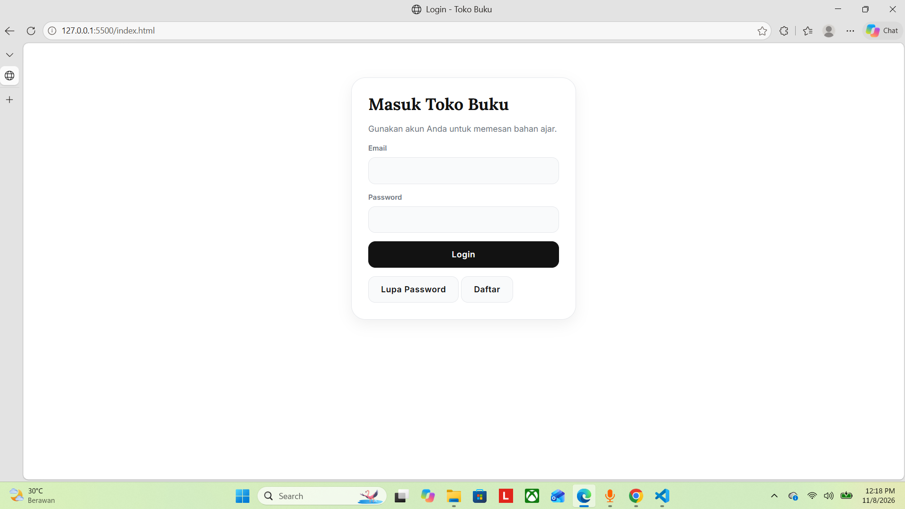
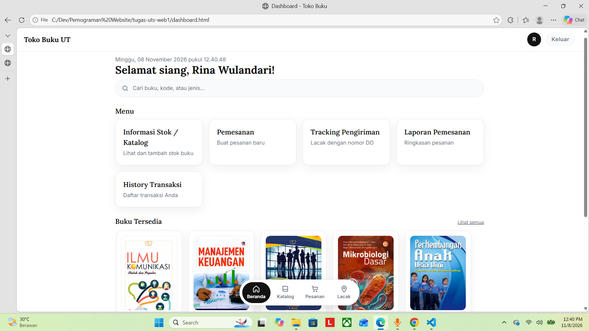
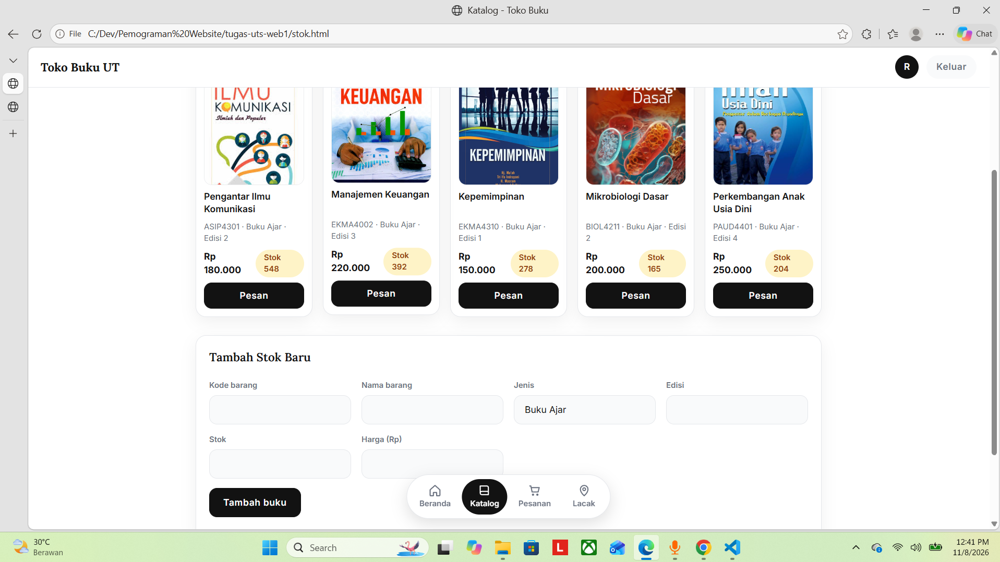
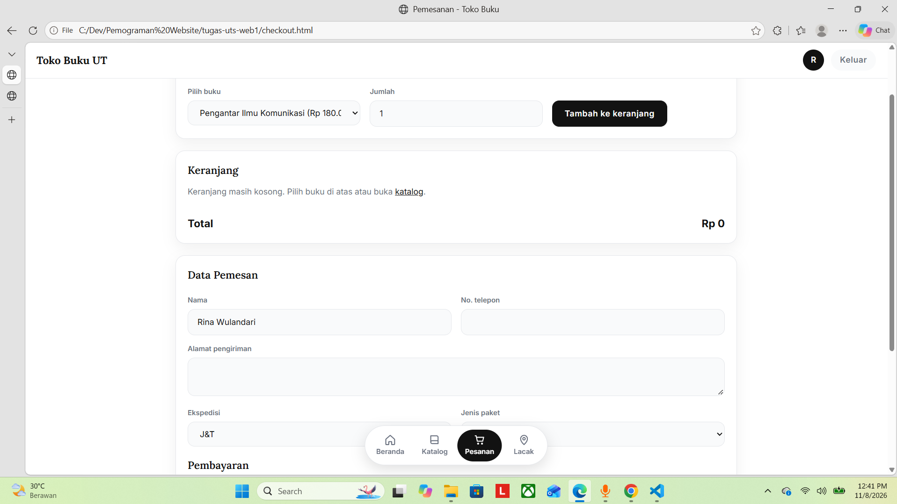
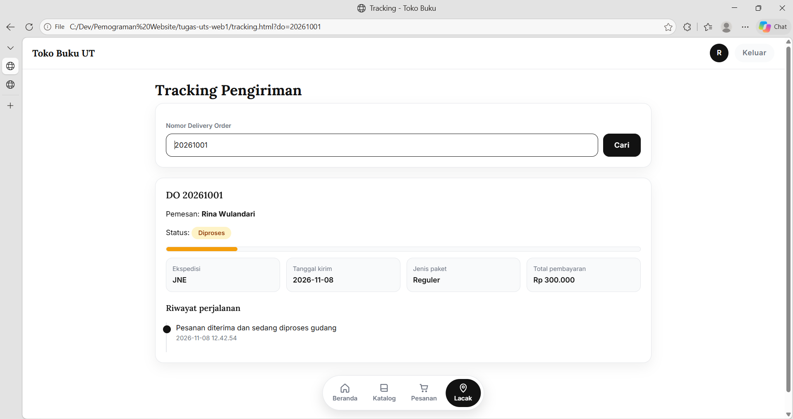
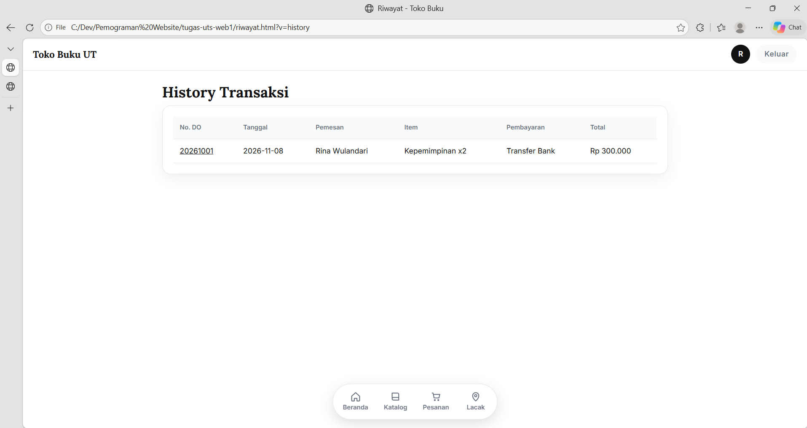

# Aplikasi Web Pemesanan Buku

Aplikasi web sederhana untuk pemesanan buku pada toko online. Proyek ini berfokus pada **front-end** (HTML, CSS, JavaScript). Tidak ada server maupun database. Data bawaan berasal dari `js/data.js`, sedangkan data baru yang dibuat pengguna disimpan di browser (`localStorage` dan `sessionStorage`).


## Link Youtube : https://youtu.be/c5i-7vH_PqA

## Daftar Isi

1. [Struktur Folder](#1-struktur-folder)
2. [Cara Menjalankan](#2-cara-menjalankan)
3. [Akun dan Data Uji](#3-akun-dan-data-uji)
4. [Alur Pengguna](#4-alur-pengguna)
5. [Penjelasan Setiap Section](#5-penjelasan-setiap-section)
6. [Penyimpanan Data](#6-penyimpanan-data)
7. [Desain Tampilan](#7-desain-tampilan)
8. [Catatan dan Batasan](#8-catatan-dan-batasan)
9. [Capture Hasil Website](#9-Capture-Hasil-Website)

---

## 1. Struktur Folder

```
tugas-uts-web1/
├── index.html        Halaman login
├── dashboard.html    Menu utama
├── stok.html         Informasi stok / katalog
├── checkout.html     Pemesanan
├── tracking.html     Informasi pengiriman
├── riwayat.html      Laporan pemesanan dan history transaksi
├── css/
│   └── style.css     Seluruh gaya tampilan
├── js/
│   ├── data.js       Data dummy (dataPengguna, dataKatalogBuku, dataTracking)
│   └── script.js     Fungsi bersama yang dipakai semua halaman
├── img/              Cover buku (sesuai isi "cover" di data.js)
└── assets/           Aset tambahan, misalnya logo (opsional)

```

Setiap halaman memuat `js/data.js` **sebelum** `js/script.js`, karena fungsi di `script.js` membaca variabel dari `data.js`.

## 2. Cara Menjalankan

1. Pastikan `js/data.js` dan folder `img/` sudah ada di lokasi di atas.
2. Buka `index.html` di browser. Cara yang disarankan adalah memakai ekstensi **Live Server** di VS Code.
3. Login memakai salah satu akun pada bagian berikutnya.

Font Inter dan Lora dimuat dari Google Fonts. Tanpa internet, tampilan memakai font cadangan sistem.

## 3. Akun dan Data Uji

| Email | Password | Role |
| --- | --- | --- |
| rina@gmail.com | rina123 | User |
| agus@gmail.com | agus123 | User |
| siti@gmail.com | siti123 | Admin |

Nomor Delivery Order untuk menguji tracking: `20230012` (Dalam Perjalanan) dan `20230013` (Dikirim, sudah selesai diantar).

## 4. Alur Pengguna

```
index.html (login)
   └── dashboard.html
         ├── stok.html ── tombol "Pesan" ──► checkout.html ──► tracking.html?do=<nomor DO>
         ├── checkout.html
         ├── tracking.html
         └── riwayat.html?v=laporan | ?v=history
```

Halaman saling terhubung lewat parameter URL, sehingga pengguna tidak perlu mengetik ulang data.

## 5. Penjelasan Setiap Section

### 5.1 `js/data.js` (data dummy)

Berisi tiga variabel global:

- **`dataPengguna`**: array akun (`id`, `nama`, `email`, `password`, `role`).
- **`dataKatalogBuku`**: array buku (`kodeBarang`, `namaBarang`, `jenisBarang`, `edisi`, `stok`, `harga`, `cover`).
- **`dataTracking`**: objek dengan kunci nomor DO, sehingga pencarian cukup `dataTracking[nomor]`. Setiap entri berisi status, ekspedisi, tanggal kirim, paket, total, dan array `perjalanan`.

File ini tidak pernah diubah oleh aplikasi.

### 5.2 `js/script.js` (fungsi bersama)

| Fungsi | Kegunaan |
| --- | --- |
| `rp(n)` | Memformat angka menjadi rupiah, misalnya `Rp 180.000`. |
| `num(s)` | Mengubah teks harga menjadi angka dengan membuang karakter bukan angka. |
| `ambil(k, d)` / `simpan(k, v)` | Membaca dan menulis JSON di `localStorage`. `ambil` aman terhadap data kosong atau rusak. |
| `getUser()` | Membaca pengguna yang sedang login dari `sessionStorage`. |
| `getKatalog()` | Menggabungkan `dataKatalogBuku` dengan stok baru dari `localStorage`. |
| `getOrders()` | Membaca daftar pesanan dari `localStorage`. |
| `logout()` | Menghapus sesi login dan kembali ke `index.html`. |
| `pasangNav(aktif)` | Menjaga halaman (pengguna yang belum login diarahkan ke login), lalu membangun header dan bottom navigation. |
| `kartuBuku(b)` | Membuat kartu buku lewat DOM. Jika cover gagal dimuat, kartu menampilkan huruf pertama judul. |

### 5.3 `index.html` (Login)

- Input email dan password. Validasi dilakukan terhadap `dataPengguna` ditambah akun baru dari `localStorage`.
- Jika salah, muncul alert **"Email/password yang anda masukkan salah"**.
- Jika benar, data pengguna disimpan di `sessionStorage` lalu halaman pindah ke dashboard.
- **Lupa Password** (modal): memeriksa apakah email terdaftar, lalu menampilkan pesan simulasi pengiriman link reset.
- **Daftar** (modal): memvalidasi nama, email, dan password (minimal 6 karakter), menolak email ganda, lalu menyimpan akun baru dengan role `User`.

### 5.4 `dashboard.html` (Menu Utama)

- **Salam** sesuai jam lokal: pagi (04.00–10.59), siang (11.00–14.59), sore (15.00–17.59), selain itu malam. Jam diperbarui setiap detik.
- Kolom pencarian yang mengarah ke katalog (`stok.html?q=...`).
- Kartu menu ke Katalog, Pemesanan, Tracking, Laporan, dan History.
- Carousel buku yang bisa digeser, dibuat dari data katalog.

### 5.5 `stok.html` (Informasi Stok / Katalog)

- Menampilkan katalog secara dinamis dari `dataKatalogBuku` sebagai grid kartu (JavaScript DOM: `createElement` dan `appendChild`).
- **Pencarian** berdasarkan judul atau kode buku.
- **Category chips** dibuat otomatis dari `jenisBarang`.
- **Tambah stok baru**: form kode, nama, jenis, edisi, stok, dan harga. Kode barang harus unik. Kartu baru langsung muncul dan tetap ada setelah halaman dimuat ulang.
- Tombol **Pesan** pada kartu membuka halaman pemesanan dengan buku tersebut sudah masuk keranjang.

### 5.6 `checkout.html` (Pemesanan)

- **Keranjang**: pilih buku dan jumlah, ubah jumlah dengan tombol − dan +, atau hapus item. Total dihitung ulang setiap ada perubahan.
- **Data pemesan**: nama (terisi otomatis), telepon (8–15 digit), alamat, ekspedisi, dan jenis paket.
- **Pembayaran**: metode pembayaran dan nomor rekening/akun (opsional).
- Saat pesanan dibuat, sistem membentuk nomor DO berurutan (`20261001`, `20261002`, dan seterusnya), menyimpan pesanan ke `localStorage`, lalu mengarahkan pengguna ke tracking.

### 5.7 `tracking.html` (Informasi Pengiriman)

- Input nomor Delivery Order. Pencarian dijalankan lewat tombol **Cari** atau tombol Enter.
- Pencarian pertama ke `dataTracking`. Jika tidak ada, mencari di pesanan baru (status **Diproses**).
- Hasil: nama pemesan, **status dengan badge dan progress bar** (Diproses 15%, Dikirim 45%, Dalam Perjalanan 75%, Selesai 100%), detail ekspedisi, tanggal kirim, jenis paket, total pembayaran, serta daftar riwayat perjalanan paket.
- Status dianggap selesai bila riwayat perjalanan memuat "Selesai Antar", dan progress bar berubah hijau.
- Jika nomor tidak ditemukan, muncul pesan yang jelas.

### 5.8 `riwayat.html` (Laporan dan History)

Satu halaman dengan dua mode lewat parameter `v`:

- **`?v=history`**: tabel transaksi, terbaru di atas, nomor DO menjadi tautan ke tracking.
- **`?v=laporan`**: ringkasan jumlah pesanan, jumlah buku, total nilai, serta rincian per judul.

Hak akses: **Admin** melihat semua pesanan, **User** hanya pesanan miliknya sendiri.

### 5.9 `css/style.css` (Tampilan)

- Variabel CSS di `:root` untuk warna, bayangan, transisi, dan font, sehingga tema bisa diganti dari satu tempat.
- Layout memakai `grid` (`auto-fill`, `minmax`) dan `flexbox`, jadi responsif tanpa banyak media query.
- Komponen utama: header, bottom navigation, kartu, kartu buku, chips, modal, keranjang, progress bar, dan timeline perjalanan.
- Satu media query untuk layar di bawah 600 px, dan `prefers-reduced-motion` untuk mematikan animasi.

## 6. Penyimpanan Data

| Data | Penyimpanan | Ditulis di | Dibaca di |
| --- | --- | --- | --- |
| Sesi login (`user`) | `sessionStorage` | `index.html` | Semua halaman lewat `getUser()` |
| Akun baru (`penggunaBaru`) | `localStorage` | `index.html` | `index.html` |
| Stok baru (`stokBaru`) | `localStorage` | `stok.html` | Dashboard, katalog, pemesanan lewat `getKatalog()` |
| Pesanan (`orders`) | `localStorage` | `checkout.html` | Tracking dan riwayat |

Untuk mengembalikan aplikasi ke data awal, buka DevTools (F12), tab **Application**, lalu hapus `localStorage` dan `sessionStorage` situs ini.

## 7. Desain Tampilan

Tampilan mengikuti pedoman *Book Store App* yang bersifat minimalis dan berfokus pada konten:

- Palet netral: `#121212` (utama), `#6B7280` (pendukung), `#FFFFFF` (latar), `#F9FAFB` (permukaan), `#E5E7EB` (garis), dan aksen amber `#F59E0B`.
- Tipografi: Inter untuk teks dan Lora untuk judul.
- Sudut membulat 12–24 px, bayangan lembut, dan transisi 200 ms.
- Cover buku berrasio 3:4 dengan border tipis.

## 8. Catatan dan Batasan

- Ini adalah simulasi front-end. Password disimpan sebagai teks biasa di data dummy, dan pada aplikasi nyata harus di-hash di server.
- `localStorage` hanya berlaku di browser dan perangkat yang sama. Data hilang jika cache atau data situs dihapus.
- Stok pada katalog tidak berkurang saat pesanan dibuat.
- Pesanan baru hanya memiliki satu langkah perjalanan ("diterima dan sedang diproses"). Perjalanan paket lengkap hanya ada pada data bawaan `dataTracking`.
- Buku yang ditambahkan lewat form tidak memiliki gambar cover.
- Link "Lupa Password" hanya simulasi dan tidak mengirim email.


## 9. Capture Hasil Website

# 1. Login


# 2. Dashboard


# 3. Katalog


# 4. Checkout


# 5. Tracking


# 6. Riwayat


